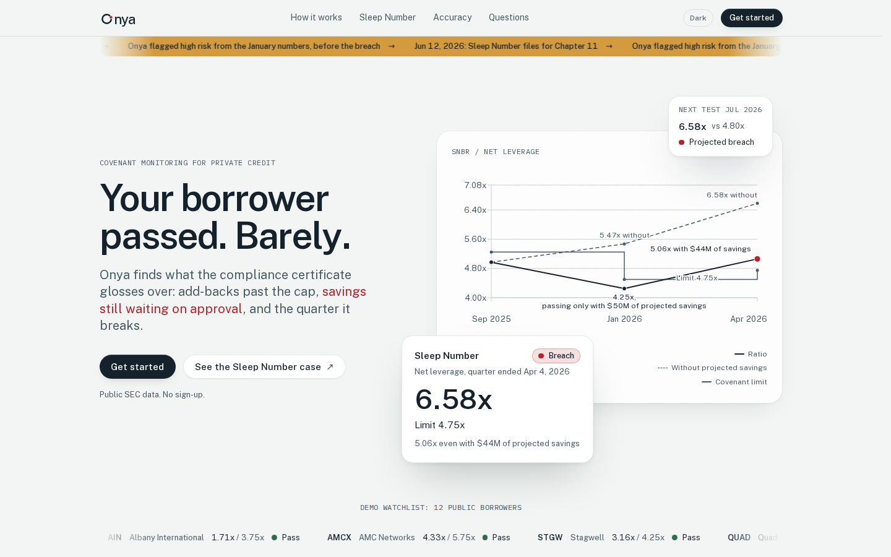
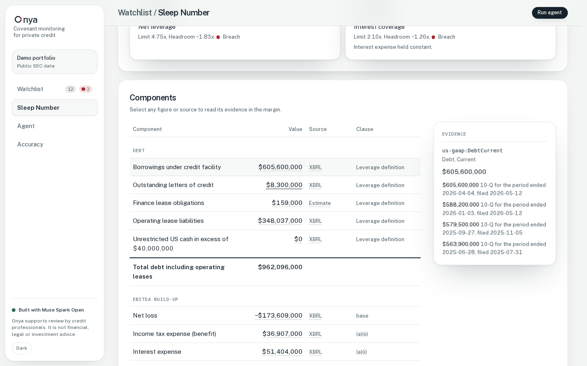
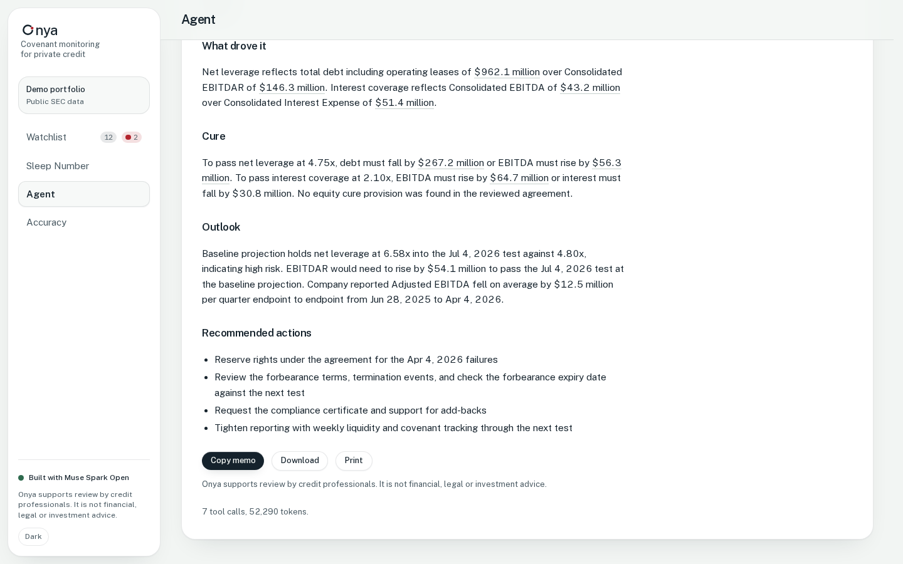
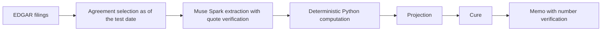

#  Onya

Onya is a covenant monitoring agent for private credit lenders.

Live demo: https://onya-g8f4.vercel.app (public SEC data, no sign-up).
Demo video: (link added at submission)





Recapture the screenshots with `node scripts/capture-readme.mjs`
(run from `web/`; captures the live site at 1440x900, light theme).

## The problem

Covenants live in long credit agreements. Lenders rebuild ratios by hand
each quarter. Add-backs, caps, step-downs and amendments hide the real
number: a borrower can pass on reported figures while breaching on the
agreement's own math. Onya reads the agreement, recomputes the ratios from
filed data, and shows which quarter breaks.

## The Sleep Number case

Sleep Number (SNBR) is the fully worked case. Net leverage by test date,
from `data/results`:

| Test date | Onya net leverage | Limit | Result |
|---|---|---|---|
| Sep 27, 2025 | 4.97x | 5.25x | Pass |
| Jan 3, 2026, with $50M projected savings | 4.25x | 4.50x | Pass |
| Jan 3, 2026, without savings | 5.47x | 4.50x | Fail |
| Apr 4, 2026, with $44M projected savings | 5.06x | 4.75x | Fail |
| Apr 4, 2026, without savings | 6.58x | 4.75x | Fail |

For Sep 27, 2025 the company disclosed a 5.0x leverage ratio against the
same 5.25x limit (`data/backtest/disclosed_SNBR.json`); Onya's 4.97x
reconciles to the company's reported covenant EBITDA to the dollar.

Then: the [forbearance agreement and thirteenth amendment, filed Apr 28,
2026](https://www.sec.gov/Archives/edgar/data/827187/000082718726000035/ex101thirteenthamendmentto.htm),
and the [Chapter 11 8-K, filed Jun 12,
2026](https://www.sec.gov/Archives/edgar/data/827187/000095010326008891/dp248362_8k.htm).
Onya flagged high risk from the January numbers, before the breach.

## How it works



EDGAR filings (`src/edgar.py`, `src/xbrl.py`) supply the raw material:
credit agreements and amendments, quarterly XBRL facts, and earnings
releases, all cached under `data/` so runs are reproducible.

Agreement selection (`select_agreement` in `src/edgar.py`) picks the
governing document using only filings dated on or before the as-of date,
so a later amendment can never leak into an earlier test.

Muse Spark extraction (`src/extract.py`) pulls thresholds, cap groups,
definition terms and the equity-cure flag from the agreement text, then
checks each value against a verbatim quote from the document. A reviewed
extraction is saved and reused instead of re-read.

Deterministic Python computation (`src/covenant.py`) does all the math:
total debt including operating leases over Consolidated EBITDAR for net
leverage, Consolidated EBITDA over Consolidated Interest Expense for
interest coverage, with shared-cap policing on add-backs. The model never
computes.

Projection (`src/project.py`) carries the latest test forward to the next
test date with cushions, trend risk and a backtest of the last call.

Cure (`src/cure.py`) turns a breach into dollar figures: the debt
reduction or EBITDA increase needed to pass, plus equity-cure status from
the reviewed file.

The memo (`draft_memo` in `src/agent.py`) is verified figure by figure
against tool output (`verify_memo_numbers`) and style-checked
(`verify_memo_format`): two-decimal ratios, lowercase risk, hyphenated
add-backs, sentence-case names, no em dashes. Each memo figure links to
the case page, where the same figure opens its evidence margin. When a
covenant is breached or the next test is high risk, the agent drafts a
lender-to-borrower information request (`src/info_request.py`) from the
computed findings; the letter is a draft marked for review and nothing is
sent anywhere.

## Meta models used

| Model | Where | What it does |
|---|---|---|
| Muse Spark 1.3 via Meta Model API | `src/extract.py`, `src/agent.py` | Agreement extraction; the agent loop that calls the tools |
| Muse Spark Open on Baseten | `src/extract_disclosed.py`, `src/backtest_terms.py` | Back-test extraction of disclosed figures and contract terms |
| Muse Code with Muse Wonder 1.0 and Muse Spark 1.3 | development | Built this repo; no runtime role |

## Accuracy

Back-test extraction was run with Muse Spark Open; the committed outputs
sit in `data/backtest/` and the site accuracy page reads them. See
[EVIDENCE.md](EVIDENCE.md) for the row-by-row sources.

- Disclosed figures: 23 of 23 matched (ratios and limits), 22 of the 23
  with a verified quote. The one match without a verified quote is AMCX
  interest coverage.
- Contract thresholds: 19 of 21 matched where the agreement covers the
  test period, each with a verified covenant quote. The other two rows are
  HAIN limits changed by later amendments, flagged and counted separately
  rather than as misses. No row mismatches. AMCX and QUAD were found by
  following incorporated-by-reference pointers from their 10-K and 10-Q
  exhibit lists. OPTX stays unread: its credit agreement (EX-10.12, Nov 14,
  2023 8-K) was filed as 56 scanned images with no text layer.
- Recomputed from filings: 12 leverage ratios across 10 companies rebuilt
  from XBRL using the extracted definitions. 0 full matches, 12 partial, 0
  mismatched. Four have a figure, and none of the four is a covenant
  calculation: CRS 0.60x vs 0.59x disclosed, TRS 2.80x vs 2.29x, GPK 5.03x
  vs 4.37x, NUVR 4.45x vs 4.99x. CRS landing close is not a match, because
  its definition has components XBRL cannot supply. The other eight could
  not be built from XBRL, and the missing components are listed for each.
  These results are not in the accuracy totals above.

## Why the numbers can be trusted

- As-of discipline: no filing dated after the test date is used, on any
  path (cached, bundled, or live discovery). Regression tests cover the
  hindsight leak (`tests/test_asof_regression.py`).
- Verbatim quote verification on extraction: values must match document
  quotes or they are flagged.
- Python does all math; the model cites tool outputs and invents no
  numbers.
- Memo numbers are verified against tool output: the sample run
  `7c2a49625f4e` (`data/samples/snbr_memo.json`) traces 42 of 42 memo
  figures to tool output, and the site proof strip cites the same
  count. The memo style check plus wording tests pin the date line
  and risk phrasing (`tests/test_agent.py` MemoValidators).

## Private check

The private page (`/app/private`, sidebar "Private check") compares a
borrower's compliance certificate with the public filings. Paste the
text or upload a PDF or .txt file (up to 2 MB, judged by content, not
the extension). Muse Spark Open extracts the reported figures on
Baseten with verbatim quote verification; Onya lines each one up
against its recalculation (certificate, Onya, difference) and flags
the gaps: add-backs above the shared cap and savings counted without
administrative agent approval. The compare streams progress events
and the result through the site proxy, counted in the Redis limits
and budget. Uploads stay in memory for the request: nothing reaches
disk, traces, logs, or caches. An illustrative sample built from
public Sleep Number filings
(`data/samples/sample_certificate_snbr.txt`) shows the real gap
(reported 5.06x against Onya's 6.58x). Without model configuration
the endpoint returns 503 and the page says private mode is
unavailable. Code: `src/private_compare.py`.

## Security and limits

- The demo token never reaches the browser: the browser only calls the
  site origin, and the site proxy adds `X-Onya-Token` server-side for
  model-calling endpoints. A bundle test fails the build if the token
  leaks into client JavaScript (`web/scripts/check-bundle-token.mjs`).
- Rate limits and the daily token budget live in Redis (`src/limits.py`)
  and fail closed in production: when Redis is unreachable, model calls
  are refused instead of running uncounted.
- Kill switch: setting `ONYA_AGENT_ENABLED` to 0 pauses the live agent
  with a clear notice (see [DEPLOY.md](DEPLOY.md)).
- Production guards refuse to boot with replay mode on or with the
  demo token or frontend origin missing (`_is_production` in
  `src/api.py`).

## Run it locally

Prerequisites: Python 3.14 and Node 24 (the versions this repo runs
under). Secrets live outside the repo in `~/.config/onya/.env`; only
variable names appear here: `META_API_KEY`, `META_BASE_URL`,
`ONYA_DEMO_TOKEN`, `BASETEN_API_KEY` and `BASETEN_BASE_URL` for the
private check, plus `UPSTASH_REDIS_REST_URL` and
`UPSTASH_REDIS_REST_TOKEN` for limits in production.

API:

```bash
.venv/bin/python -m uvicorn app:app --port 8001
```

Site (from `web/`, with `ONYA_API_BASE` pointing at the API and
`ONYA_DEMO_TOKEN` in `.env.local`):

```bash
npm run dev
```

Tests, with counts from a real run:

```bash
.venv/bin/python -m unittest tests.test_agent tests.test_api ...  # 559 passed
cd web && npm run test:what-if   # 17 passed
cd web && npx playwright test    # 12 passed
```

(The Python suite runs as named `tests.test_*` modules; bare discovery
finds none.)

## Deploy

See [DEPLOY.md](DEPLOY.md) for the Vercel projects, env vars, and the
kill switch.

## Built during the hackathon

Built Oct 26 to Nov 4, 2026. First commit in this repo: `c16dbc4`,
Oct 30, 2026 ("Project setup and Meta API test").

Later passes and the final code review used Claude Code.

## Limitations

- Sleep Number is the one fully worked case. The other eleven borrowers
  are back-tested on disclosed figures and contract thresholds only.
- Private mode compares one borrower and period per request against
  the committed SNBR results; only SNBR periods with computed results
  are supported.
- The demo runs on public data only, except for text the visitor
  pastes or uploads on the private page, which stays in memory for
  that request.

## License and notices

Built with Muse Spark Open. Use of the model is subject to the
[Muse Model License](https://huggingface.co/meta-models/Muse-Spark-Open-816B-A42B/blob/main/LICENSE.md).

Onya supports review by credit professionals. It is not financial, legal
or investment advice.
